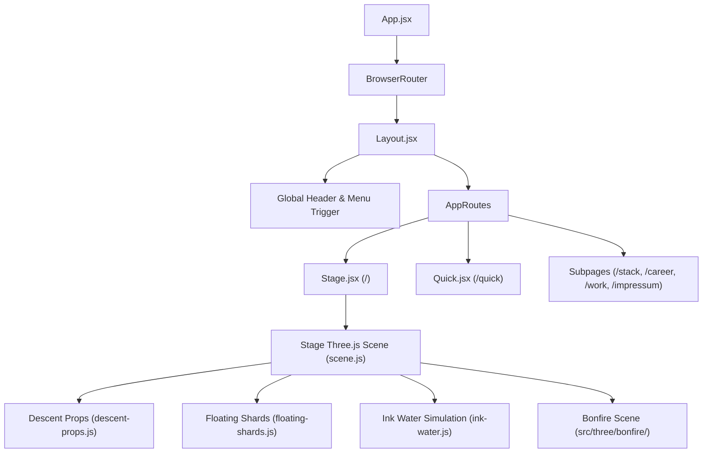

# Architecture Documentation

Technical architecture of `richardzuikov.com`: render loop orchestration, scroll-to-rail projection, stateless props system, test-hook contracts, and file ownership boundaries.

---

## 1. System Overview

The site is built as a single-page application (SPA) with React 18, Vite 5, and Three.js. It features a dual-experience architecture:

1. **The Stage (`/`)**: An interactive 3D WebGL scene hosting the Atlus Neo-Pop navigation, manga-style project cards, interactive skills boards, career records, and a Dark Souls-inspired 3D bonfire scene.
2. **Quick Read (`/quick`)**: A clean, accessible, lightweight long-scroll document designed for low-bandwidth environments, screen readers, and fast evaluation by recruiters.



---

## 2. The Unified Render Loop

### 2.1 Single-Driver requestAnimationFrame
The application maintains strictly **one** global `requestAnimationFrame` driver loop residing in `src/components/stage/scene.js`. Multiple independent RAF loops are explicitly prohibited to prevent frame desynchronization, micro-stutter, and redundant GPU context switches.

### 2.2 The 4 Render Stages (Execution Order)
Every tick of the render loop executes four deterministic phases in linear order:

```
[Phase 1: Scroll & Rail] ──> [Phase 2: Scene & Props] ──> [Phase 3: WebGL Draw] ──> [Phase 4: DOM Proxy Sync]
```

1. **Phase 1: Scroll & Camera Rail Sampling**
   - The Lenis smooth-scroll instance reports the normalized scroll progress `t` and interpolated scroll position `scrollY`.
   - The camera position `(x, y, z)` and orientation `quaternion` are sampled along the camera rail spline.
   - Field of view (FOV) is dynamically adapted based on viewport aspect ratio (desktop vs mobile).
2. **Phase 2: Scene & 3D Props Evaluation**
   - Background geometry (rings, shards, ambient mesh planes) updates its phase offsets.
   - The descent props module evaluates stateless position formulas for each active prop based on current camera space and panel viewport anchors.
   - Frustum culling and collision avoidance sweeps determine mesh visibility.
3. **Phase 3: WebGL Draw Call**
   - Three.js `renderer.render(scene, camera)` issues GPU draw commands to the shared canvas.
   - **Canvas clear ownership**: `scene.js` exclusively owns `gl.clear()` with obsidian background `#050505` (`rgb(5, 5, 5)`). Child components, vignettes, and props must **never** clear or rebind the primary framebuffer.
4. **Phase 4: DOM Proxy Synchronization & Test Hook Emission**
   - For accessibility, SEO, and visual testing, projected 3D coordinates are mirrored onto DOM proxies (`[data-prop="..."]`).
   - If in development mode or `?e2e=1` is active, the projected coordinates and visibility flags are emitted into `window.__propScreenPos`.

### 2.3 Overlay Pause / Resume Lifecycle
When an overlay dialog or sub-screen is opened:
- Full-screen overlays (`/about`, `/work`, `/stack`, `/career`, `MenuOverlay`, Card Inspect lightbox) signal the loop orchestrator.
- The render loop halts `requestAnimationFrame` execution or clamps rendering to 0 Hz, dropping GPU idle usage to 0%.
- When the overlay is dismissed, the loop resumes at the exact recorded scroll position without triggering spring jitter or camera teleportation.

---

## 3. Scroll → Lenis → Camera Rail Architecture

### 3.1 Single-Source Easing (The "No Double-Smoothing" Rule)
Scroll motion is eased **strictly once** at the Lenis level:
- Lenis provides physical wheel damping and smooth momentum interpolation.
- Inside Three.js, camera transforms, prop offsets, and rail positions consume the interpolated scroll values **directly** (`lerp` or spring dampening inside Three.js on top of Lenis is forbidden).
- Double-smoothing introduces phase-lag, rubber-banding, and spatial drift between DOM elements and 3D meshes.

### 3.2 Coordinate Space Transformation
The system coordinates three distinct spaces:
1. **Window Viewport Space**: Measured in CSS pixels (`0, 0` top-left, `1440 × 900` bottom-right).
2. **Three.js World Space**: Measured in Three.js world units, centered at `(0, 0, 0)`, with $+X$ right, $+Y$ up, $+Z$ toward camera.
3. **Manga Panel Gutter Slots**: The 2D layout boxes beside each panel (`[data-slot="panel-N"]`) where props reside.

Conversion factor between Viewport Pixels and Three.js World Units at distance $Z$:
$$k = \frac{2 \cdot \tan\left(\frac{\text{FOV} \cdot \pi}{360}\right) \cdot |Z_{\text{camera}} - Z_{\text{target}}|}{\text{window.innerHeight}}$$

---

## 4. The Props System: Stateless Projection

### 4.1 The Stateless Formula
`src/components/stage/descent-props.js` implements a purely functional, stateless projection architecture.
- **Why No Mutable Springs?** Historical spring physics accumulated frame-delta divergence, leading to irrecoverable visual drift across rapid scroll reversals.
- **Stateless Law**: For any given scroll position $Y$ and camera state $C$, the position of prop $i$ must evaluate to the exact same projected pixel coordinates $(x, y)$, regardless of whether the user scrolled top-to-bottom, bottom-to-top, or warped directly to a hash anchor.

### 4.2 Panel Association & Gutter Slots
- Each prop is permanently assigned to an immutable panel index (`PROPS = [ { panel: 0, build: chip }, ... ]`).
- The prop calculates its rest anchor by reading its panel's bounding box and finding the outer gutter:
  - If panel is on viewport right $\to$ prop anchor is centered in left gutter (`[0, rect.left]`).
  - If panel is on viewport left $\to$ prop anchor is centered in right gutter (`[rect.right, viewportWidth]`).
- Collision sweep: If the gutter width is smaller than the prop bounding radius (`radius * 2 + GUTTER_MARGIN * 2`), the prop cleanly culls with reason `'gutter <width>'`.

### 4.3 Mobile & Narrow Viewport Fallback
On screens with viewport width $< 768\text{px}$ (or when `narrow === true`):
- All 3D Three.js descent meshes are culled and unmounted from the scene graph.
- The UI seamlessly renders lightweight, static 2D SVG badges (`src/assets/badges/`) inline within the manga panel headers.
- This guarantees zero WebGL overhead on budget mobile chips while preserving editorial hierarchy.

---

## 5. Test-Hook Contract: `window.__propScreenPos`

### 5.1 Schema
```typescript
interface PropScreenPosPayload {
  frame: number;
  props: Array<{
    id: 'chip' | 'pcb' | 'monitor' | 'rack' | 'dome';
    visible: boolean;
    inFrustum: boolean;
    scene: 'descent' | 'detached';
    reason: 'ok' | 'narrow' | 'no-panel' | 'gutter' | 'collision';
    x: number; // Viewport X in pixels (0 to viewportWidth)
    y: number; // Viewport Y in pixels (0 to viewportHeight)
  }>;
}
```

### 5.2 Exposure Rules
- Exposed **only** when `import.meta.env.DEV === true` OR query parameter `?e2e=1` is present in the URL.
- When `?e2e=1` is supplied, it is persisted to `sessionStorage` so that the hook remains available across sub-screen navigation round-trips (`/about`, `/work`, etc.).
- In production builds without `?e2e=1`, `window.__propScreenPos` is `undefined` (zero surface area, zero overhead).

### 5.3 E2E Test Reading Rules
- Automated tests (Playwright) must wait for scroll interpolation to settle (`page.waitForTimeout(300)` or frame delta $< 0.1\text{px}$) before asserting on coordinates.
- Reading coordinates mid-wheel-dispatch while momentum is active is prohibited.

---

## 6. Team & File Ownership Map

| Domain / Paths | Primary Owner | Secondary Reviewer | Modification Policy |
| :--- | :--- | :--- | :--- |
| `src/components/**`, `src/pages/**` | **Claude Code** (`feat/atlus-*`) | Antigravity | Do not touch without coordination. Code review required. |
| `src/three/bonfire/**`, `public/textures/bonfire/**` | **Antigravity** | Claude Code | Isolated 3D bonfire scene. |
| `design/**`, `design/research/**` | **Antigravity** (`docs/*`, `lab/*`) | Richard | Architectural research, reviews, and design benchmarks. |
| `.github/workflows/**`, `.github/tests/**` | **Antigravity** (`test/*`, `chore/ci-docs`) | Richard | CI pipelines, Playwright E2E suites, security scans. |
| `docs/ARCHITECTURE.md`, `docs/adr/**` | **Antigravity** | Claude Code, Richard | Living canon for system architecture and ADRs. |
| Release Merges, Branch Deletion | **Richard** | — | Sole owner of `main` merges, prod deployments, and project secrets. |
