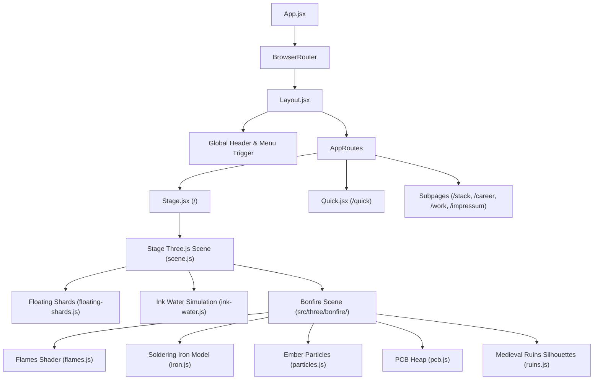

# Architecture Documentation

Technical architecture of `richardzuikov.com`: routing, Atlus Neo-Pop stage, Three.js WebGL graphics, data layer, and internationalization.

---

## 1. System Overview

The site is built as a single-page application (SPA) with React 18, Vite 5, and Three.js. It features a dual-experience architecture:

1. **The Stage (`/`)**: An interactive 3D WebGL scene hosting the Atlus Neo-Pop navigation, manga-style project cards, interactive skills boards, career records, and a Dark Souls-inspired 3D bonfire scene.
2. **Quick Read (`/quick`)**: A clean, accessible, lightweight long-scroll document designed for low-bandwidth environments, screen readers, and fast evaluation by recruiters.

---

## 2. Routing & Navigation Map

Routing is orchestrated in `src/App.jsx` using `react-router-dom` v6 with dynamic code-splitting via `React.lazy()` and `React.Suspense`.

### Active Routes

| Route | Page Component | Description |
| :--- | :--- | :--- |
| `/` | `src/pages/Stage.jsx` | Full Atlus stage experience with WebGL canvas and DOM overlay |
| `/quick` | `src/pages/Quick.jsx` | Fast, accessible long-scroll resume & overview |
| `/stack` | `src/pages/Stack.jsx` | Deep dive into technical toolset, technologies, and proficiencies |
| `/career` | `src/pages/Career.jsx` | Career journey, education, and milestones |
| `/work` | `src/pages/Work.jsx` | Project showcase and portfolio items |
| `/impressum` | `src/pages/Impressum.jsx` | Impressum & legal notice (German/English) |
| `/datenschutz`| `src/pages/Impressum.jsx` | Privacy policy alias |
| `/legal` | `src/pages/Impressum.jsx` | English legal alias |
| `*` | `src/pages/NotFound.jsx` | Custom 404 error page |

### Route Redirects

To preserve backward compatibility with legacy links and portfolio sections:
- `/contact` ➔ redirects to `/#bonfire` (owner decision per DESIGN.md §8)
- `/lab`, `/works`, `/portfolio`, `/dev` ➔ redirects to `/#arcana`

### Transition Mechanics

Route transitions utilize `useWipeLocation` (`src/hooks/use-wipe-location.js`), rendering an animated manga slash-wipe panel (`.wipe-panel` in `src/css/style.scss`) that sweeps across the viewport on navigation changes.

---

## 3. Atlus Stage & Viewport Synchronization

The core visual experience resides in `src/pages/Stage.jsx` and `src/components/stage/scene.js`.

### Hybrid DOM / WebGL Integration
- Three.js operates in a fixed background canvas (`#stage-canvas`).
- Interactive buttons, navigation links, and text labels are rendered as real semantic HTML elements positioned over WebGL objects using CSS transforms and bounding-box measurements (`getBoundingClientRect`).
- Guarantees full accessibility (a11y), natural text selection, keyboard navigation (`Tab`, `Esc`, `Enter`), and search engine discoverability.

### Stage Submodules (`src/components/stage/`)
- `scene.js`: Central Three.js manager initializing camera, scene graph, lights, post-processing shaders, and rendering loop.
- `floating-shards.js`: 40–60 flat-shaded geometric polygon shards drifting in 3D space, reactive to cursor physics (spring recoil).
- `ink-water.js`: Dynamic sumi-e ink fluid simulation beneath the stage slabs.
- `CardInspect.jsx`: Modal view providing close-up inspection of tarot project cards with keyboard and mouse controls.
- `ProjectDeck.jsx`: Card carousel orchestrating project transitions with 3D depth perspective.

### Atlus Manga UI Components (`src/components/atlus/`)
- `SkillBoard.jsx` & `SkillVignette.jsx`: Manga panel displaying skills categorized by engineering discipline with speedlines and halftone effects.
- `RecordBoard.jsx`: Career timeline featuring flipping year numerals, slanted expanding bars, and role details.
- `KeyItems.jsx`: Visual inventory representation for certifications and achievements.
- `ArcanaCard.jsx`: Project cards styled as Major Arcana tarot cards.
- `CausticsBackground.jsx`: Atmospheric procedural background illumination.

---

## 4. Three.js Bonfire Subsystem (`src/three/bonfire/`)

Located at the bottom of the home stage (`#bonfire`), the bonfire represents a safe haven inspired by *Dark Souls*, featuring a soldering iron plunged into a pile of charred PCBs and embers.

### Module Breakdown
- `index.js`: Mount point initializing the bonfire scene, camera positions, landing zoom animations, and intersection observers.
- `flames.js`: Multi-layered procedural flame shader with turbulence noise, bright inner core, and heat haze distortion.
- `iron.js`: 3D procedural geometry representing a soldering iron with real proportions:
  - Conical tip, metallic barrel with hex nut, heat-insulating finger guard disc, ribbed ergonomic grip, and strain-relief stub.
- `pcb.js`: Procedural circuit board rubble with etched traces and heat discoloration.
- `particles.js`: Rising ash particles, floating embers, and flickering sparks.
- `ruins.js`: Atmospheric distant medieval castle silhouettes with fog fading on the right, keeping the left text area high-contrast.
- `stones.js` & `logs.js`: Stone perimeter ring and scorched wooden logs.
- `quality.js`: Device performance tiering detecting mobile/desktop to throttle particle counts and disable heavy shader passes.
- `ContactList.jsx`: Interactive contact cards (Email, GitHub, LinkedIn) rendered above the bonfire.

---

## 5. Data Architecture & Models (`src/data/`)

Static content is structured in decoupled data modules:

- `featured-projects.js`: Portfolio project metadata, tech stack tags, Major Arcana associations (e.g. *The Magician*, *The Tower*), and live/code repository links.
- `portraits.js`: Responsive portrait image sets across multiple resolutions (640w, 1200w, WebP formats).
- `project-images.js`: Mapping of visual media and screenshots for project cards.
- `stack-uses.js`: Detailed technical breakdown of daily drivers, languages, frameworks, cloud infrastructure, and hardware tools.

---

## 6. Internationalization (i18n)

Localization is implemented without external runtime bloat in `src/lib/translations.js` and consumed via `src/hooks/use-language.js`:

- Supported languages: **German (`de`)** and **English (`en`)**.
- Stored in browser `localStorage` under `rz_lang` with automatic fallback to browser navigator language.
- Missing translations default cleanly to English keys.
- Strictly adheres to the rule: *Never invent facts. Unconfirmed data points remain flagged or omitted.*

---

## 7. Performance & Optimization Strategy

As specified in `design/DESIGN.md §8`:

1. **Shader Pre-compilation**: All custom GLSL shaders are pre-warmed via `renderer.compileAsync` before starting the render loop to prevent frame drops on first interaction.
2. **Dynamic Framerate Capping**:
   - Desktop runs at 60 fps.
   - Mobile (< 768 px) is capped at 30 fps with halved particle densities and disabled bloom.
   - Loop pauses completely when the document tab is hidden (`document.hidden`).
3. **Texture Loading**: Textures are lazily loaded with `createImageBitmap` and downscaled before GPU upload.
4. **Bundle Budgets**:
   - Initial JS chunk ≤ 100 KB gzip.
   - Three.js 3D scene chunk ≤ 400 KB gzip (currently ~211 KB gzip).
